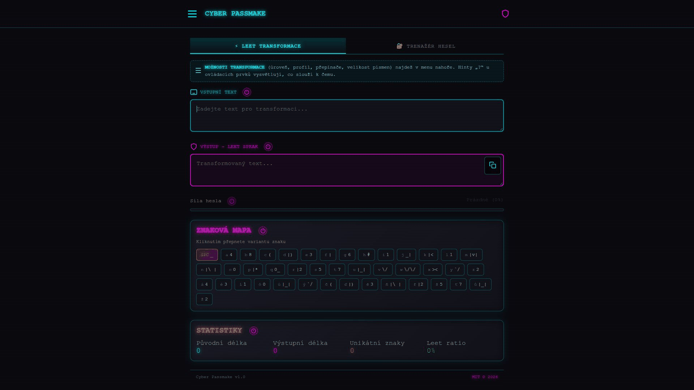

# Cyber Passmake

[English](README.md)

> 🚀 **Spustit online v prohlížeči:** [https://school.vibemaker.cz/passmake/](https://school.vibemaker.cz/passmake/)  
> *(Běží přímo v prohlížeči · PWA offline · Bez instalace a registrace)*

Česká a anglická výuková aplikace pro leetspeak, rozpoznávání předvídatelných hesel a práci s hesly. Obsahuje převodník textu, kvíz s 23 otázkami, trenažér, ověření znalosti a PNG certifikáty.

Procvičuj na smyšlených heslech. Jde o výukový model, nikoli správce hesel nebo bezpečnostní audit. Vlastní zjednodušený analyzátor se inspiruje rozpoznáváním vzorů; knihovnu zxcvbn neobsahuje. Skóre ani certifikát nepotvrzují bezpečnost hesla.

## Spuštění

Aplikace nepotřebuje sestavení, backend ani instalaci závislostí:

1. **Online:** Otevři [https://school.vibemaker.cz/passmake/](https://school.vibemaker.cz/passmake/)
2. **Offline / Lokálně:** Otevři `passmake.html` přímo v libovolném moderním prohlížeči (dvojklik stačí).

Kořenový `index.html` přesměrovává na hlavní vstup `passmake.html`. Přidání na plochu a automatická offline cache fungují při spuštění přes zabezpečené HTTPS.

## Jazyky

Při prvním otevření rozhoduje hlavní jazyk prohlížeče: české nastavení zvolí češtinu, ostatní angličtinu. Poloha se nezjišťuje. Přepínač EN/CS si pamatuje ruční volbu a zachová zadaný text, rozehraný kvíz i nastavení. Česká a anglická znaková mapa jsou dostupné v obou jazycích rozhraní.

Přeložené jsou otázky, vysvětlení, popisky, nápověda i certifikáty. České příklady slov a paměťové věty zůstávají, pokud je úloha závislá na jejich zápisu. Známkování používá českou stupnici 1–5 i v angličtině.

## Přidání na plochu

V menu zvol **Instalovat na plochu**. Podporované prohlížeče otevřou systémovou výzvu, jinak aplikace nabídne návod.

- iPhone/iPad: Safari → Sdílet → Přidat na plochu, případně ponechat Otevřít jako webovou aplikaci
- Android: nabídka prohlížeče → Instalovat aplikaci / Přidat na plochu
- macOS Safari: Soubor → Přidat do Docku

Podrobnosti uvádí [návod Applu](https://support.apple.com/guide/iphone/iphea86e5236/ios). Před odpojením vyčkej na **Připraveno bez internetu**. Prohlížeč může cache později odstranit. Sada ikon obsahuje neprůhlednou 180px ikonu pro iPhone, PNG 192/512 px, samostatný bezpečný ořez pro Android a vektorové zdroje v `icons/`.

## Soukromí

Texty, cvičná hesla, jména, odpovědi i výsledky zůstávají v paměti stránky. Do localStorage se ukládá pouze jazyk. Service worker ukládá výhradně seznam souborů aplikace, nikdy vstupy ani certifikáty. Aplikace nemá analytiku, vzdálené API ani CDN.

Zavření certifikátu trenažéru vymaže jeho heslové pole. Obnovení stránky zahájí novou relaci. Aplikace nemůže zaručit forenzní odstranění dat z paměti prohlížeče či systému. Kopírování na vyžádání předá text systémové schránce. Stažený certifikát obsahuje zadané jméno, výsledek a čas, nikdy heslo; lze použít přezdívku. Odkazy autora se otevírají až kliknutím.

## Omezení modelu a hodnocení

Leet, počet tříd znaků ani odhad entropie samy nepotvrzují bezpečnost hesla. Některé náměty slouží k ukázce předvídatelných konstrukcí a nejsou doporučením pro reálné účty. Lokální klíč kvízu lze prohlédnout, nejde o zabezpečený zkouškový systém. Původní české příklady a prahy cvičení zůstávají zachované.

## Soubory

- `passmake.html`: rozhraní, překlady, otázky a logika aplikace
- `index.html`: přesměrování na vstup aplikace
- `manifest.webmanifest`, `sw.js`: instalace a cache souborů
- `icons/`: vektorové zdroje a mobilní varianty
- [Ověření](docs/VERIFICATION.md): provedené kontroly a omezení testování

## Licence a autor

MIT, copyright © 2026 Luděk Sušický. Viz [LICENSE](LICENSE).

### Autor

**Luděk Sušický** — biolog, středoškolský a vysokoškolský učitel informatických předmětů

- E-mail: [ludek.susicky@gmail.com](mailto:ludek.susicky@gmail.com)
- X: [@ludeksusicky](https://x.com/ludeksusicky)
- LinkedIn: [Luděk Sušický](https://www.linkedin.com/in/ludek-susicky/)
- GitHub: [@siberius](https://github.com/siberius) — další vzdělávací projekty a otevřené aplikace

Aplikace je příkladem SPA (Single Page Application) v jediném HTML souboru.

[Repozitář na GitHubu](https://github.com/siberius/passmake)

### Poznámka k autorství

Při vývoji programu byly využity nástroje generativní AI. Návrh vzdělávacího obsahu, jeho úpravy a odpovědnost za výslednou podobu náleží autorovi.
